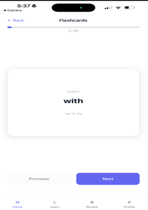
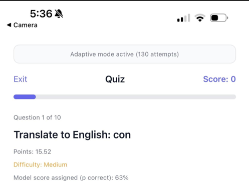
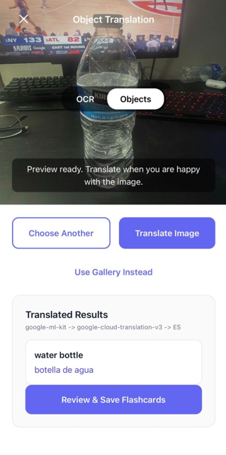
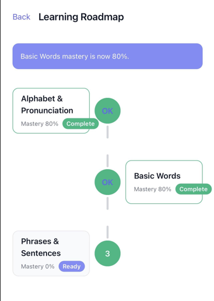

# Verbo — AI-Powered Language Learning

A full-stack mobile language-learning project built with **React Native, TypeScript, Expo, and Firebase**. Verbo combines camera-assisted vocabulary discovery, interactive practice, and adaptive learning to help users connect everyday objects and words with new languages.

## At a glance

- **Learn from your surroundings:** photograph objects or text and turn recognition results into vocabulary.
- **Practice interactively:** use flashcards, quizzes, and review workflows.
- **Track learning progress:** see a learning roadmap and performance-related insights.
- **Personalize practice:** backend adaptive-scoring logic uses quiz-performance signals to estimate recall and help prioritize review.

## App screenshots

<table>
<tr>
<td align="center"><strong>Flashcards</strong></td>
<td align="center"><strong>Adaptive quiz</strong></td>
<td align="center"><strong>Object translation</strong></td>
<td align="center"><strong>Learning roadmap</strong></td>
</tr>
<tr>
<td align="center"></td>
<td align="center"></td>
<td align="center"></td>
<td align="center"></td>
</tr>
</table>

*Screenshots are from development builds. Data shown on a screen may reflect demonstration content or configured backend responses.*

## Technology stack

| Layer | Technology |
| --- | --- |
| Mobile | React Native, TypeScript, Expo, React Navigation |
| Server-side | Node.js, Express, Firebase Cloud Functions |
| Authentication and storage | Firebase Authentication, Cloud Firestore |
| Vision | Expo Camera, Google ML Kit, Hugging Face Florence-2 integration |
| Learning logic | Adaptive scoring, external model-inference integration |
| Developer tools | Git, GitHub, Android/iOS native development builds |

## Core functionality

### Camera-assisted vocabulary discovery

The camera interface supports image capture and vocabulary discovery workflows. In the **active camera path**, **Expo Camera** captures the image and **Google ML Kit** handles text recognition (OCR) and object detection. Recognized content can be translated, reviewed, and saved as vocabulary through backend services.

I also developed a separate **Hugging Face Florence-2** integration service (`functions/src/services/huggingFace.ts`) with code for OCR and object-detection requests. That service is present in the repository, but **it is not currently connected to the active ML Kit recognition path**.

### Interactive learning

- Flashcards for vocabulary review and recall practice.
- Quiz flows with answer selection, scoring, and progression.
- Review queues, learner profiles, and roadmap/progress screens.
- Firebase-backed API operations for learning records, quizzes, and vocabulary in the backend implementation.

### Adaptive review and personalization

The backend computes learning signals from quiz performance—such as correctness, recent performance, and response behavior—to support recall-probability estimates and personalized practice. It can call an externally hosted model endpoint (configured through `XGB_CLOUD_RUN_URL`) and has a local scoring fallback.

**Model reproducibility note:** The XGBoost training pipeline and trained XGBoost artifact are not included in this public repository. The repository shows the backend integration and fallback scoring logic rather than a reproducible model-training workflow.

## Architecture

```text
React Native / Expo app
  ├── Firebase Authentication
  ├── Camera capture (Expo Camera)
  │     └── Active recognition: Google ML Kit
  │           └── Translation / vocabulary review
  └── Authenticated API client
           └── Firebase Cloud Functions (Express)
                  ├── Firestore: vocabulary, quizzes, progress
                  ├── Adaptive scoring / optional model endpoint
                  └── Separate Hugging Face Florence-2 service
```

## Repository structure

```text
src/                 Mobile screens, components, authentication, API client
functions/src/       API routes and backend services
functions/models/    Local adaptive-scoring configuration
android/             Android native project
ios/                 iOS native project
assets/              App assets
screenshots/         Images featured in this README
App.tsx              Application entry point
```

## Getting started

**Requirements:** Node.js, a configured Firebase project, and Android Studio or Xcode for the relevant platform. Some features also require external service configuration.

```bash
git clone https://github.com/Manisingh02/Verbo.git
cd Verbo
npm install
```

Create your local environment file from the example and configure your own Firebase values:

```bash
cp .env.example .env
```

For a native development build:

```bash
npx expo run:android
# or, on macOS with Xcode:
npx expo run:ios
```

To build the backend locally:

```bash
cd functions
npm install
npm run build
```

> **Note:** Native ML Kit dependencies require an appropriate development build rather than Expo Go. Cloud services, permissions, and optional vision/model endpoints must be configured to exercise their full functionality.

## Development notes

Verbo includes implemented application and backend code alongside integrations requiring additional setup. Not every backend service or ML workflow can be run end-to-end directly from this repository without its corresponding external environment or model service. The README distinguishes the active camera recognition implementation from the separate Florence-2 service for clarity.

## License

See [LICENSE](LICENSE) for repository license terms.
